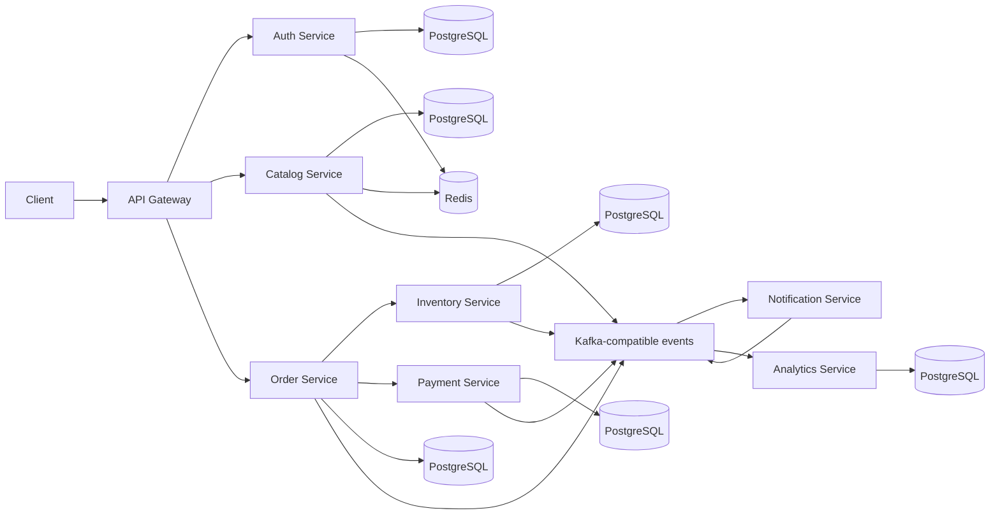

# Commerce Platform

A polyglot microservices application that models a small commerce checkout. A shopper registers, browses products, reserves inventory, places an order, completes a simulated payment, receives a simulated notification, and produces analytics events.

## Features

- Shopper registration, login, and JWT-protected order access.
- Product catalog with pricing and a short-lived Redis cache.
- Checkout that reserves stock, authorizes and captures a simulated payment, then confirms the order.
- A decline path that marks the order failed and releases the inventory reservation.
- Cancellation that requests a simulated refund and releases reserved stock.
- Domain events on one Kafka-compatible topic for notification and analytics consumers.
- A React shopper UI for catalog, cart, checkout, notifications, and analytics.

Each data-owning service has its own PostgreSQL database. Services share the event envelope described in [docs/events.md](docs/events.md).

## Services and tech stack

| Service | Stack | Port | Responsibility |
|---|---|---:|---|
| Web App | React, Vite, Nginx | 5173 | Shopper UI |
| API Gateway | TypeScript, NestJS | 8080 | Public HTTP entry point and routing |
| Auth | TypeScript, NestJS | 3001 | Registration, login, JWT identities, Redis session hints |
| Catalog | TypeScript, NestJS | 3002 | Product CRUD, pricing, Redis cache |
| Order | TypeScript, NestJS | 3003 | Checkout orchestration and order status |
| Inventory | TypeScript, NestJS | 3004 | Transactional stock reservation and release |
| Payment | Java 21, Spring Boot | 8085 | Simulated authorize, capture, and refund |
| Notification | Python, FastAPI | 8001 | Event-driven simulated customer messages |
| Analytics | Python, FastAPI | 8002 | Event-consumed reporting read model |

Local backing services are PostgreSQL 16 (one database per owning service), Redis 7, and Redpanda as a Kafka-compatible broker. The shared event helpers live in `shared/typescript` and `shared/python`.



Diagrams for the Compose layout and the checkout flow are in [docs/architecture](docs/architecture/README.md). The original application drawing is [docs/architecture.svg](docs/architecture.svg).

## Run locally with Docker Compose

Prerequisites: Docker with Compose, and `curl` if you use the demo scripts.

From the repository root:

```bash
docker compose up --build -d
./commerce-demo/seed.sh
./commerce-demo/demo-flow.sh
```

Open the shopper UI at `http://localhost:5173`. The API gateway is at `http://localhost:8080`.

`compose.yml` supplies local defaults when the variables in `.env.example` are unset or empty. To override them, copy that file to an untracked `.env` and assign values there. Do not commit `.env`.

Initial image builds compile the Node, Java, and Python services. After the stack is up:

```bash
docker compose ps
curl http://localhost:8080/health
```

Stop the application with `docker compose down`. Named database volumes keep demo data. Add `--volumes` only when you want empty databases.

`make up`, `make down`, `make logs`, and `make seed` wrap the same Compose and demo commands.

### Routes

The gateway maps `/api/{service}` to the owning service:

- `/api/auth/register`, `/api/auth/login`, `/api/auth/me`
- `/api/catalog/products`
- `/api/inventory`, `/api/inventory/reservations`
- `/api/orders`
- `/api/payments/authorizations`, `/api/payments/payments/{id}/capture`, `/api/payments/payments/{id}/refund`
- `/api/notifications/deliveries`
- `/api/analytics/summary`, `/api/analytics/events`

Every service exposes `GET /health`. NestJS services expose OpenAPI JSON at `/openapi.json`. FastAPI and Spring Boot expose Swagger UI at `/docs`. Spring Boot also reports health at `/actuator/health`.

Create an order with payment method `decline` to exercise the failed-payment path. Cancelling a confirmed order triggers a simulated refund and releases its reservation.

### Databases

| Service | PostgreSQL container | Host port | Database |
|---|---|---:|---|
| Auth | `auth-db` | 5433 | `auth` |
| Catalog | `catalog-db` | 5434 | `catalog` |
| Inventory | `inventory-db` | 5435 | `inventory` |
| Order | `order-db` | 5436 | `orders` |
| Payment | `payment-db` | 5437 | `payments` |
| Analytics | `analytics-db` | 5438 | `analytics` |

Host database ports bind to `127.0.0.1`. Redis is on port `6379`. The external Kafka listener is `19092`; containers use `redpanda:9092`.

## Tests

Prerequisites: Node.js 22+, Java 21 with Maven, and Python 3.

```bash
npm ci
npm test
mvn -f services/payment-service/pom.xml test

python3 -m venv .venv
.venv/bin/pip install -r services/notification-service/requirements.txt -r services/analytics-service/requirements.txt
cd services/notification-service && ../../.venv/bin/python -m pytest
cd services/analytics-service && ../../.venv/bin/python -m pytest
```

`make install` then `make test` runs the same suites. `npm run build` compiles the TypeScript workspaces. `docker compose config --quiet` checks the Compose file. `make validate` runs that Compose check, Terraform fmt and validate, shellcheck, and Helm lint.

## Deployment

Production runs on EKS in `us-east-1`. The domain is a Terraform variable. `example.com` is only the example in `terraform.tfvars.example`.

- [Architecture](docs/ARCHITECTURE.md) for the cluster, ingress, and data path
- [Setup](docs/SETUP.md) for the state bucket, secrets, and the two-stage apply
- [Pipeline](docs/PIPELINE.md) for CI, image build, Terraform plan, and the production approval gate
- [Runbooks](docs/RUNBOOKS/deploy.md) for deploy, rollback, teardown, data stores, and incidents
- [ADRs](docs/ADR/0001-why-eks.md) for EKS, data stores, Argo CD, and state locking

`make plan`, `make apply`, `make kubeconfig`, and `make teardown` take `ENV=dev` or `ENV=production`. They are not run as part of local Compose.

Service-level notes live in each service directory. Schema synchronization is enabled so local setup stays small; a later evolution would replace it with explicit migrations.

## Environment variables

Tracked `.env.example` files list names only. Set values in an untracked `.env`. Compose reads the root file. Each service example lists the names that service reads when you run it outside Compose.

### Root

`POSTGRES_USER`, `POSTGRES_PASSWORD`, `JWT_SECRET`, `KAFKA_BROKERS`, `REDIS_URL`, `ENVIRONMENT`, `VITE_API_URL`

`VITE_API_URL` is a web image build argument. Vite embeds it in the static assets, so changing it requires a rebuild of `web-app`.

### API Gateway

`PORT`, `AUTH_SERVICE_URL`, `CATALOG_SERVICE_URL`, `ORDER_SERVICE_URL`, `INVENTORY_SERVICE_URL`, `PAYMENT_SERVICE_URL`, `NOTIFICATION_SERVICE_URL`, `ANALYTICS_SERVICE_URL`

### Auth

`PORT`, `DATABASE_URL`, `REDIS_URL`, `JWT_SECRET`

### Catalog

`PORT`, `DATABASE_URL`, `REDIS_URL`, `KAFKA_BROKERS`, `SEED_DEMO`

### Order

`PORT`, `DATABASE_URL`, `INVENTORY_SERVICE_URL`, `PAYMENT_SERVICE_URL`, `KAFKA_BROKERS`, `JWT_SECRET`

### Inventory

`PORT`, `DATABASE_URL`, `KAFKA_BROKERS`

### Payment

`PORT`, `DATABASE_URL`, `DATABASE_USER`, `DATABASE_PASSWORD`, `KAFKA_BROKERS`

### Notification

`KAFKA_BROKERS`

### Analytics

`DATABASE_URL`, `KAFKA_BROKERS`

Compose also sets `POSTGRES_DB` on each database container and `SERVICE_NAME` on the TypeScript images. Those names are not in the example files.
