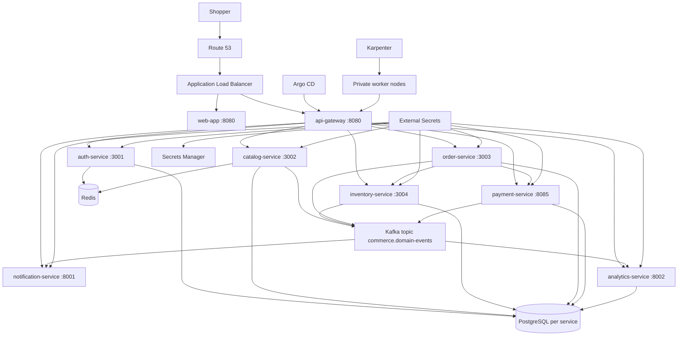

# Platform architecture

The commerce application stays a set of containers. This layer runs those containers on EKS and keeps delivery in git.

The public hostnames are `shop.<domain>` for the UI and `api.<domain>` for the gateway. Argo CD uses `argocd.<domain>` on an internal load balancer. `domain` is a Terraform variable. `example.com` appears only in the example tfvars.

## What runs where

| Piece | Where it is defined |
| --- | --- |
| VPC, subnets, NAT | `terraform/modules/network` |
| EKS control plane, baseline nodes, addons, OIDC | `terraform/modules/cluster` |
| Image repositories | `terraform/modules/ecr` |
| Zone and certificate | `terraform/modules/dns` |
| Backup and asset buckets | `terraform/modules/storage` |
| GitHub OIDC and IRSA roles | `terraform/modules/identity` |
| Controllers, Argo CD, Prometheus | `terraform/modules/platform` |
| Service Deployments, Services, Ingress, HPA, PDB | `helm/atelier` |

Baseline nodes are a managed node group in the private subnets. Karpenter adds capacity from the same subnets. The AWS Load Balancer Controller creates the ALB from the Ingress. external-dns writes the records. External Secrets materializes Secrets Manager JSON into Kubernetes Secrets. No secret value is stored in git.

Postgres, Redis, and Kafka are not Terraform modules. Dev can run them in the cluster. The managed alternative is recorded in [ADR 0002](ADR/0002-data-stores.md).

## Request path

A shopper hits the ALB, which routes `/` on the shop host to `web-app` and every path on the api host to `api-gateway`. The gateway still proxies `/api/{service}` to the service ClusterIP, using the same ports as `compose.yml`. Order checkout still calls inventory on port 3004 and payment on port 8085. Domain events still use the topic `commerce.domain-events`.
