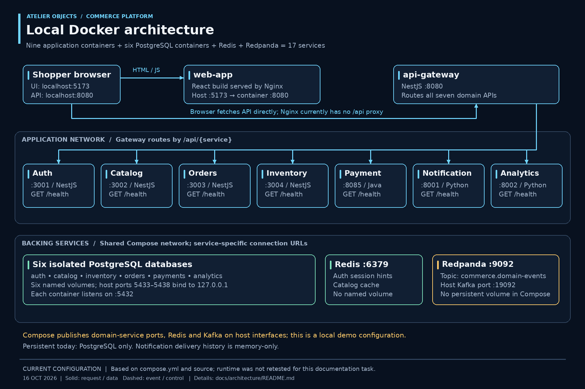
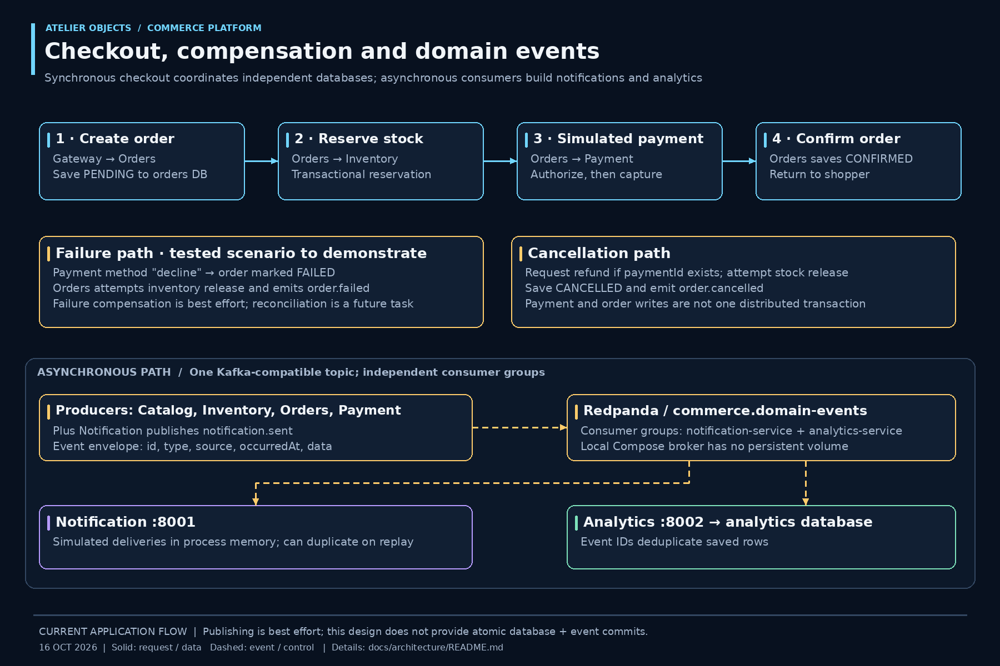

# Application documentation

Documentation for the commerce application: what the services do, how they talk, and how to run them locally.

## Start here

1. Read the [root README](../README.md) for the service map, Compose commands, tests, and environment variable names.
2. Review the [architecture diagrams](architecture/README.md).
3. Use the [event contract](events.md) when producing or consuming `commerce.domain-events`.
4. Follow [local development](runbooks/local-development.md) to start the stack and run the test suites.

## Architecture gallery

| Image | What it explains | Editable source |
| --- | --- | --- |
| [Docker](architecture/01-docker-architecture.png) | Compose services, ports, and storage | [SVG](architecture/01-docker-architecture.svg) |
| [Checkout and events](architecture/04-checkout-and-events.png) | Successful checkout, compensation, cancellation, and consumers | [SVG](architecture/04-checkout-and-events.svg) |
| [Application drawing](architecture.svg) | Synchronous calls, events, and service-owned databases | SVG |

