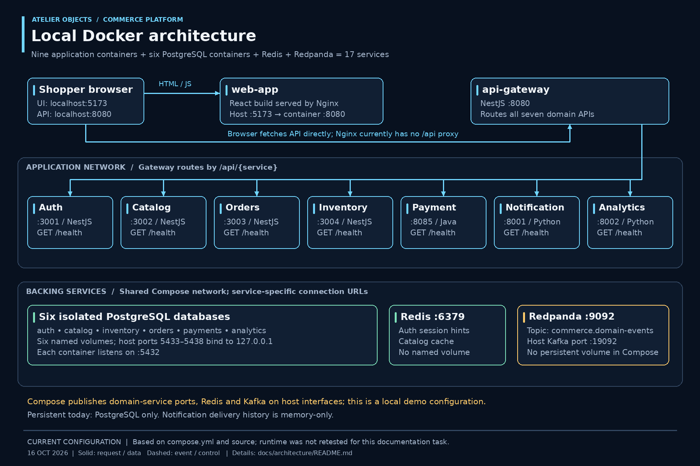
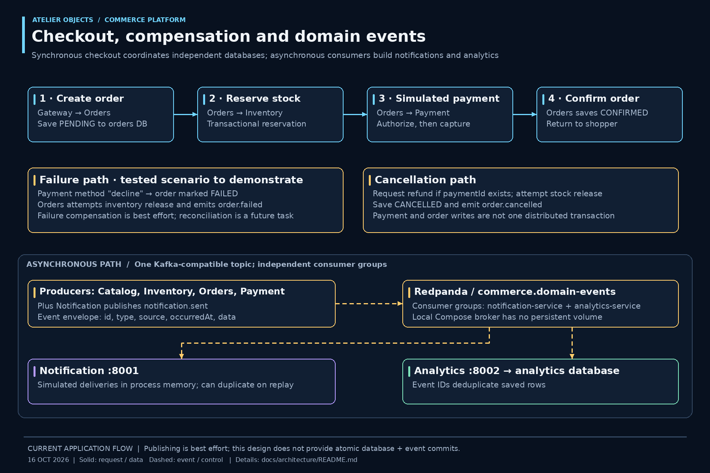

# Architecture guide

These notes match `compose.yml`, the service source, the Dockerfiles, and [the event contract](../events.md).

## Local Docker architecture



Compose defines **17 services**: nine application containers, six PostgreSQL containers, Redis, and Redpanda. The default Compose network supplies service-name DNS. PostgreSQL has six named volumes. Redis and Redpanda have no declared persistent volumes.

| Application | Container port | PostgreSQL owner | Other dependencies |
| --- | ---: | --- | --- |
| `web-app` | 8080 (host 5173) | None | Browser calls the gateway |
| `api-gateway` | 8080 | None | Routes to all seven domain services |
| `auth-service` | 3001 | `auth` | Redis; JWT signing |
| `catalog-service` | 3002 | `catalog` | Redis; Kafka producer |
| `order-service` | 3003 | `orders` | Inventory, Payment; JWT verification; Kafka producer |
| `inventory-service` | 3004 | `inventory` | Kafka producer |
| `payment-service` | 8085 | `payments` | Kafka producer |
| `notification-service` | 8001 | None | Kafka consumer and producer; memory-only delivery list |
| `analytics-service` | 8002 | `analytics` | Kafka consumer |

The browser loads assets from `localhost:5173`, then calls `localhost:8080` using the compiled `VITE_API_URL`. Nginx serves static assets and `/health`. It does not proxy `/api`. The gateway removes `/api/{service}` when forwarding to a domain service. For example, `/api/catalog/products` becomes `/products` at Catalog.

All database containers listen on 5432. Their host bindings 5433–5438 are loopback-only. Application ports, Redis 6379, and the external Kafka listener 19092 are also published by Compose. The internal broker address is `redpanda:9092`.

## Checkout and events



Orders saves PENDING, reserves inventory, authorizes and captures a simulated payment, then saves CONFIRMED. The decline scenario marks the order FAILED and attempts stock release. Cancellation requests a refund, attempts stock release, and records CANCELLED. These operations span independent stores and do not form an atomic distributed transaction. Some compensation errors are swallowed by the demo implementation.

Catalog, Inventory, Orders, and Payment publish to `commerce.domain-events`. Notification consumes selected events and publishes `notification.sent`. Analytics consumes the same topic using another group. Analytics deduplicates by event ID. Notification does not persist or deduplicate deliveries. Several publishers swallow broker errors, so a successful database write does not prove the event was published.

## Editing the images

PNG files are 1800 × 1200. SVG files contain the vector artwork. Geometry and labels come from one renderer:

```sh
python3 docs/architecture/sources/render_diagrams.py
```

Python 3 and Pillow are required. Run the command from the repository root. The renderer looks for Arial on macOS or DejaVu Sans on Linux. Override `DIAGRAM_FONT` and `DIAGRAM_FONT_BOLD` with font-file paths if needed. It writes the Docker and checkout SVG/PNG pairs.

## Sources

[Compose](../../compose.yml), [gateway routing](../../services/api-gateway/src/main.ts), [order orchestration](../../services/order-service/src/order.service.ts), [event contract](../events.md), and the [web image](../../services/web-app/Dockerfile).
