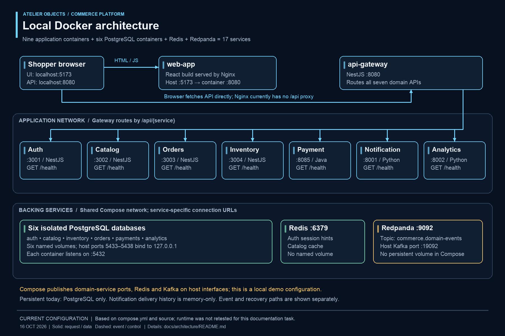
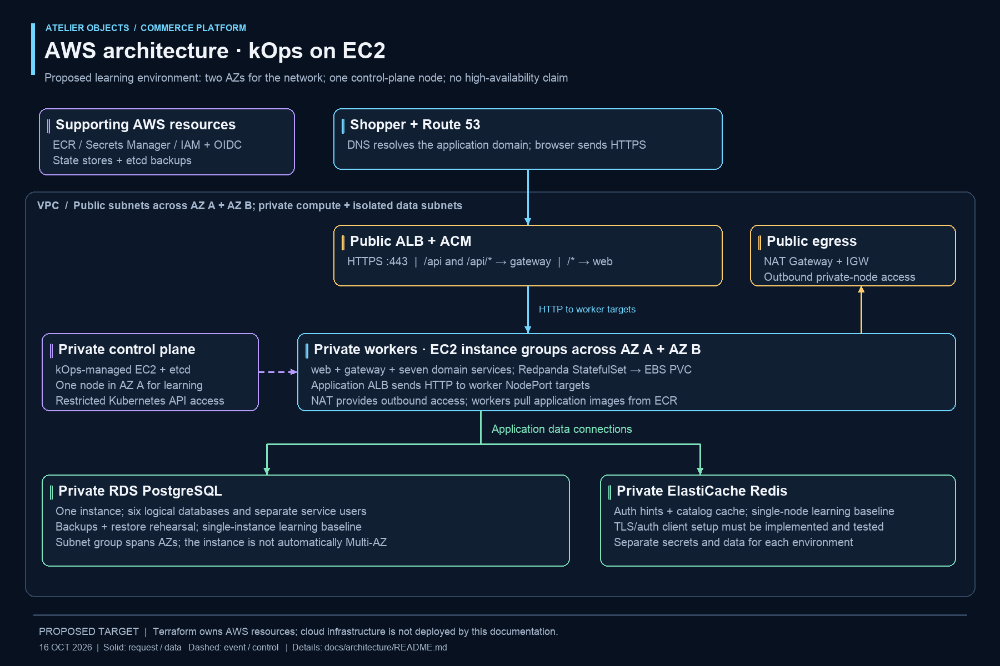
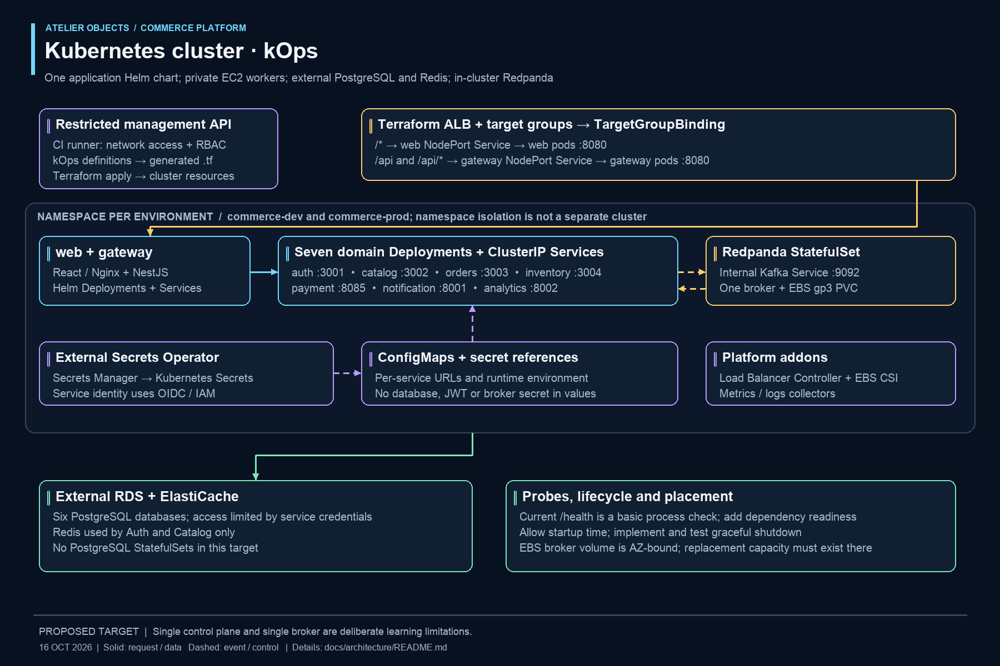
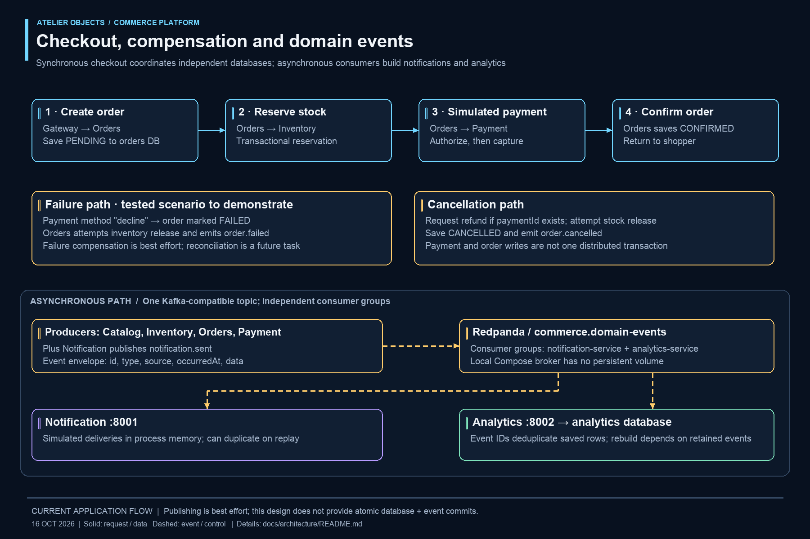
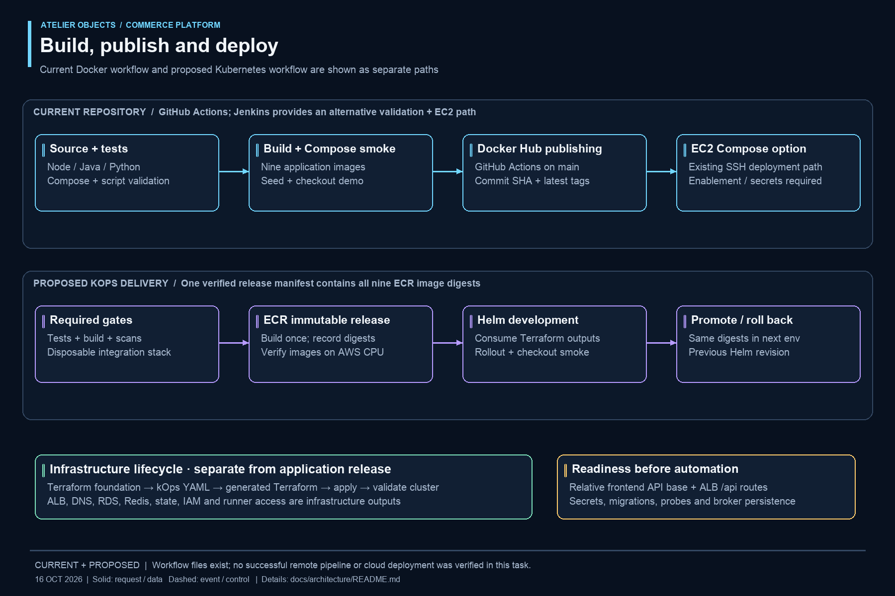
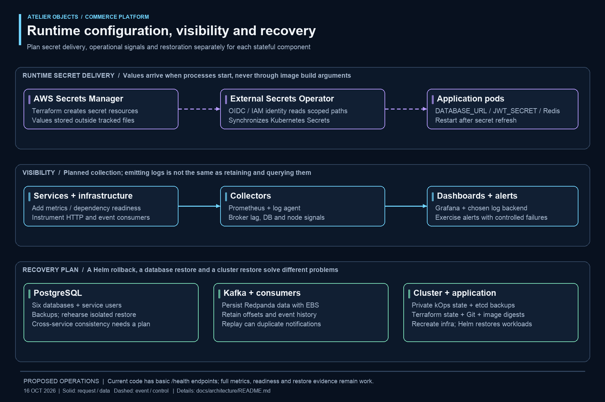

# Architecture guide

This guide accompanies the [seven architecture images](../README.md#architecture-gallery). Names, paths and ports were checked against `compose.yml`, service source, Dockerfiles, `docs/events.md`, the Makefile and existing delivery files on 16 October 2026.

## 1. Local Docker architecture — current configuration



Compose defines **17 services**: nine application containers, six PostgreSQL containers, Redis and Redpanda. The default Compose network supplies service-name DNS. PostgreSQL has six named volumes. Redis and Redpanda currently have no declared persistent volumes.

| Application | Container port | PostgreSQL owner | Other dependencies |
| --- | ---: | --- | --- |
| `web-app` | 8080 (host 5173) | None | Browser calls the gateway |
| `api-gateway` | 8080 | None | Routes to all seven domain services |
| `auth-service` | 3001 | `auth` | Redis; JWT signing |
| `catalog-service` | 3002 | `catalog` | Redis; Kafka producer |
| `order-service` | 3003 | `orders` | Inventory, Payment; JWT verification; Kafka producer |
| `inventory-service` | 3004 | `inventory` | Kafka producer |
| `payment-service` | 8085 | `payments` | Kafka producer |
| `notification-service` | 8001 | None | Kafka consumer and producer; memory-only delivery list |
| `analytics-service` | 8002 | `analytics` | Kafka consumer |

The browser loads assets from `localhost:5173`, then calls `localhost:8080` using the compiled `VITE_API_URL`. Nginx currently serves static assets and `/health`; it does not proxy `/api`. The gateway removes `/api/{service}` when forwarding to a domain service. For example, `/api/catalog/products` becomes `/products` at Catalog.

All database containers listen on 5432; their host bindings 5433–5438 are loopback-only. Application ports, Redis 6379 and the external Kafka listener 19092 are also published by Compose, without loopback-only bindings. Restrict these in a cloud deployment. The internal broker address is `redpanda:9092`, not `localhost:19092`.

## 2. AWS architecture — proposed kOps target



Use a VPC with public subnets in two availability zones for the application ALB and egress, private compute subnets, and isolated data subnets. Start with one private control-plane EC2 node and workers sized after measuring the full polyglot stack. A single control plane, one NAT gateway, one database instance, one cache node and one broker are learning tradeoffs; two network AZs alone do not make this deployment highly available.

Terraform provisions network, IAM, ECR, DNS, ACM, the application ALB/listeners/target groups, Secrets Manager resources, remote state, RDS and ElastiCache. kOps supplies cluster and instance-group definitions and generates Terraform for cluster resources. Keep generated cluster state separate from foundation state, and do not let both configurations own the same AWS resource. kOps remains the configuration source for its generated files. [kOps Terraform integration](https://kops.sigs.k8s.io/terraform/)

RDS contains six logical databases with separate service users. This preserves data ownership while reducing the initial number of instances; it shares one availability and performance boundary. Automated initialization must create databases and roles without manual SQL or SSH. Use a controlled job or an automated provisioning step with private connectivity.

Run Redis in private ElastiCache. Keep Redpanda inside Kubernetes initially, with a persistent volume and explicit retention. MSK or a resilient broker cluster is a later decision requiring client authentication, networking, cost and recovery work.

## 3. Kubernetes architecture — proposed



One `commerce` Helm chart defines nine application Deployments and Services. Non-edge services use ClusterIP. For the initial target, web and gateway use NodePort Services bound to Terraform-created **instance-type** target groups. The Load Balancer Controller reconciles TargetGroupBinding membership; it does not create a second application ALB. This avoids depending on routable pod IPs before selecting and validating the kOps CNI. [TargetGroupBinding documentation](https://kubernetes-sigs.github.io/aws-load-balancer-controller/latest/guide/targetgroupbinding/targetgroupbinding/)

Route `/api` and `/api/*` to the gateway; send other paths to web. Both targets receive unchanged paths, then the gateway applies its existing domain routing. Public HTTPS terminates on ACM/ALB. The Kubernetes management API has a separate, restricted endpoint. The deployment runner needs both network access and Kubernetes authorization.

Replace the frontend's environment-specific API origin with same-origin requests before claiming unchanged frontend-image promotion. Its client already appends `/api/...`; an empty API base is the intended same-origin value. Nginx can keep serving assets while ALB sends API traffic directly to the gateway.

Use External Secrets Operator with a scoped AWS service-account identity. ConfigMaps carry ordinary runtime values; Kubernetes Secrets carry credentials. Secret refresh must be followed by a controlled pod restart when values are injected as environment variables.

The Redpanda StatefulSet needs stable advertised internal DNS, an EBS CSI StorageClass/PVC, a selected AZ, retention and recovery procedures. An EBS volume is AZ-bound. Keep capacity available in that AZ; a worker in another AZ cannot simply attach the volume. Database and cache services stay outside Kubernetes.

Namespaces `commerce-dev` and `commerce-prod` can provide two learning environments in one cluster. They need separate databases, secret paths, broker topics/groups or broker instances, and cache isolation. Current hardcoded topic and consumer group names must be made configurable before sharing a broker between environments. Namespaces are not independent fault or security boundaries by themselves.

## 4. Checkout and events — current application



Orders saves PENDING, reserves inventory, authorizes and captures a simulated payment, then saves CONFIRMED. The decline scenario marks the order FAILED and attempts stock release. Cancellation requests a refund, attempts stock release and records CANCELLED. These operations span independent stores and do not form an atomic distributed transaction; some compensation errors are deliberately swallowed by the demo implementation.

Catalog, Inventory, Orders and Payment publish to `commerce.domain-events`. Notification consumes selected events and publishes `notification.sent`; Analytics consumes the same topic using another group. Analytics deduplicates by event ID. Notification does not persist or deduplicate deliveries. Several publishers swallow broker errors, so database success does not prove durable event publication. An outbox/retry and reconciliation design is a future correctness improvement.

## 5. Delivery — existing artifacts and proposed target



GitHub Actions and Jenkins files exist for testing, builds, Compose smoke and optional EC2 delivery. GitHub Actions includes Docker Hub publishing. Presence of these files is not evidence that remote runs pass; an existing uncommitted workflow change was preserved during this task.

The new target uses GitHub Actions, nine ECR image digests and direct Helm deployment. Build and test the same candidate images that will be published; the existing flow rebuilds for publishing and needs adjustment. A release manifest records all nine digests so promotion and rollback operate on a coherent release. Jenkins or GitOps can be added later if justified. They are not prerequisites for this smaller plan.

## 6. Runtime and recovery — proposed



Basic `/health` routes already exist. Dependency-aware readiness, comprehensive application metrics, log collection, consumer lag alerts and tracing need implementation. Do not copy AgriBridge's `/healthz`, `/readyz`, `/metrics` or `/version` endpoints into manifests as if they existed here. For web, `/health` checks Nginx; for most backend services the basic route does not prove dependency connectivity.

Back up the six PostgreSQL databases, broker data/offsets, etcd and kOps state independently. Git and Helm can recreate workloads but cannot restore lost business data. Read the [recovery plan](../disaster-recovery/recovery-plan.md) before destructive rehearsals.

## Editing the images

PNG files are 1800 × 1200. SVG files contain vector shapes and editable text. Their geometry and labels come from one repository-owned renderer, avoiding label differences between exports.

```sh
# Python 3 and Pillow are required. Run from the repository root.
python3 docs/architecture/sources/render_diagrams.py
```

The renderer looks for Arial on macOS or DejaVu Sans on Linux. Override `DIAGRAM_FONT` and `DIAGRAM_FONT_BOLD` with font-file paths if needed. It writes the seven SVG/PNG pairs; it does not change application code, containers or cloud resources. These images use deterministic vector drawing and raster export rather than generative image output.

## Evidence and sources

Repository evidence: [Compose](../../compose.yml), [gateway routing](../../services/api-gateway/src/main.ts), [order orchestration](../../services/order-service/src/order.service.ts), [event contract](../events.md), [web build](../../services/web-app/Dockerfile), and [smoke script](../../scripts/ci-smoke-test.sh). External implementation guidance is linked at the relevant design decisions above. Select and verify compatible tool versions during implementation; these diagrams do not prescribe current release numbers.
